# Learning Linux processes with a cricket worker

I used a small cricket commentary program for this lab. Every few seconds, it bowls a ball,
picks a random result, and prints the score. This gave me a running process I could stop,
kill, restart, and watch through systemd.

I started with `worker.py`. The screenshots below show that version.
The updated program is `app.py`: it sends a heartbeat every five seconds, starts a new
innings after all out, and lets me change settings through environment variables.

The service name is **cricket-worker** throughout this document. There are two ways we ran it:

| Version | Commands | Runs as |
|---|---|---|
| Earlier experiments shown in screenshots | `systemctl --user … cricket-worker` | My login user |
| Final setup from `setup.sh` | `sudo systemctl … cricket-worker` | A separate cricket-worker account |

These are managed separately. I should stop the earlier user service before running the final
system service. The name is the same; `--user` chooses the user manager.

## Starting small

Before writing the worker, I tried `sleep 100` to understand jobs. I used `fg` to bring a job
back to the terminal and `bg` to let it continue in the background. Ctrl+Z paused a job;
Ctrl+C asked the foreground job to stop.

I also tried `nohup sleep 100 &`. I learned that nohup lets a command ignore the hangup signal,
but it will not bring a crashed program back. That is one reason to use systemd.

Once the cricket worker was ready, I ran it:

```bash
python3 worker.py
```

It printed its PID, then started the match. The PID gave me a way to target this particular
process from another terminal.

## Asking the match to stop

First, I wanted to see whether the worker could stop cleanly. Its Python code handles
SIGTERM by setting a flag so the loop can end normally.

In another terminal, I ran:

```bash
kill -15 80096
```

I expected the worker to print its shutdown message and final score. That is what happened:
it printed “Rain stops play,” showed the score, and signed off.

Back in the worker's terminal, I checked:

```bash
echo $?
```

The result was `0`. The program had received a signal, but it handled that signal and reached
the end of its code successfully.

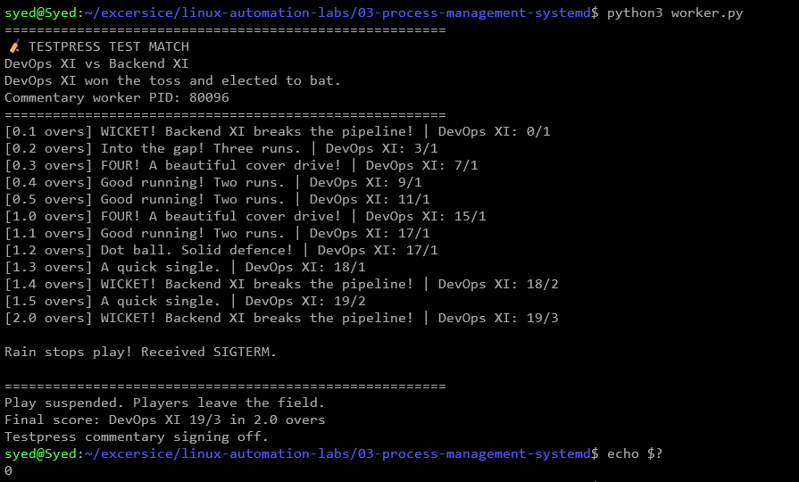

I tried Ctrl+C too. It sends SIGINT rather than SIGTERM, but my code handles both signals.
Again, I got the final score and exit status `0`.

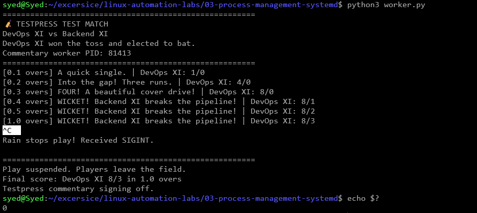

The useful lesson here was that SIGTERM only asks a process to stop. The program needs to
handle it properly if it wants to finish work or save data before exiting.

## Stopping it by force

Next, I started a fresh match and used its new PID:

```bash
kill -9 80343
```

This time, I expected the commentary to stop without a final message. The terminal printed
`Killed`. There was no rain message, score summary, or sign-off.

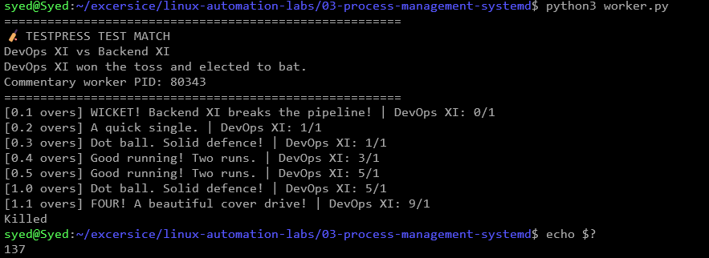

When I checked `echo $?`, I got `137`. Bash uses `128 + signal number` for this result,
so `128 + 9 = 137`. The worker did not choose that exit code itself.

SIGKILL cannot be caught or ignored. I would normally try SIGTERM first and use SIGKILL when
a process will not stop.

## Letting systemd run the match

Running Python in a terminal worked, but I wanted something to manage it in the background.
I checked the first Linux process:

```bash
ps -p 1 -o comm=
```

It printed `systemd`, so I could use systemd in WSL.

I created a service that told systemd which Python command to run, which directory to use,
and when to restart it. Then I started it and looked at its status:

```bash
systemctl --user start cricket-worker
systemctl --user status cricket-worker --no-pager
journalctl --user -u cricket-worker -f
```

I expected the service to show `active (running)` and the journal to show the commentary.
The screenshot shows the worker running under systemd.

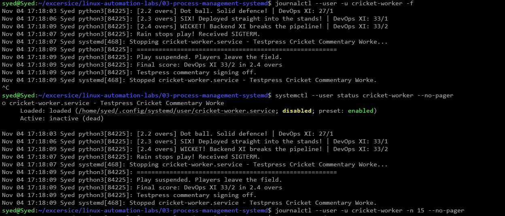

The journal saved the worker's printed messages. Pressing Ctrl+C while following the journal
only closed the log viewer; it did not stop the match.

I also learned that `disabled` in the status does not mean a service cannot run. It means it
has not been enabled for automatic startup.

## Seeing whether it comes back after a crash

I set:

```ini
Restart=on-failure
RestartSec=3
```

Then I checked the PID and killed the main process:

```bash
systemctl --user show cricket-worker -p MainPID
systemctl --user kill --signal=SIGKILL --kill-whom=main cricket-worker
```

I expected systemd to notice the failure, wait three seconds, and start another match.

The old process was PID `84664`. It was killed at `17:20:08 UTC`. At `17:20:11 UTC`,
systemd started PID `84908`. The journal also showed a restart counter of one.

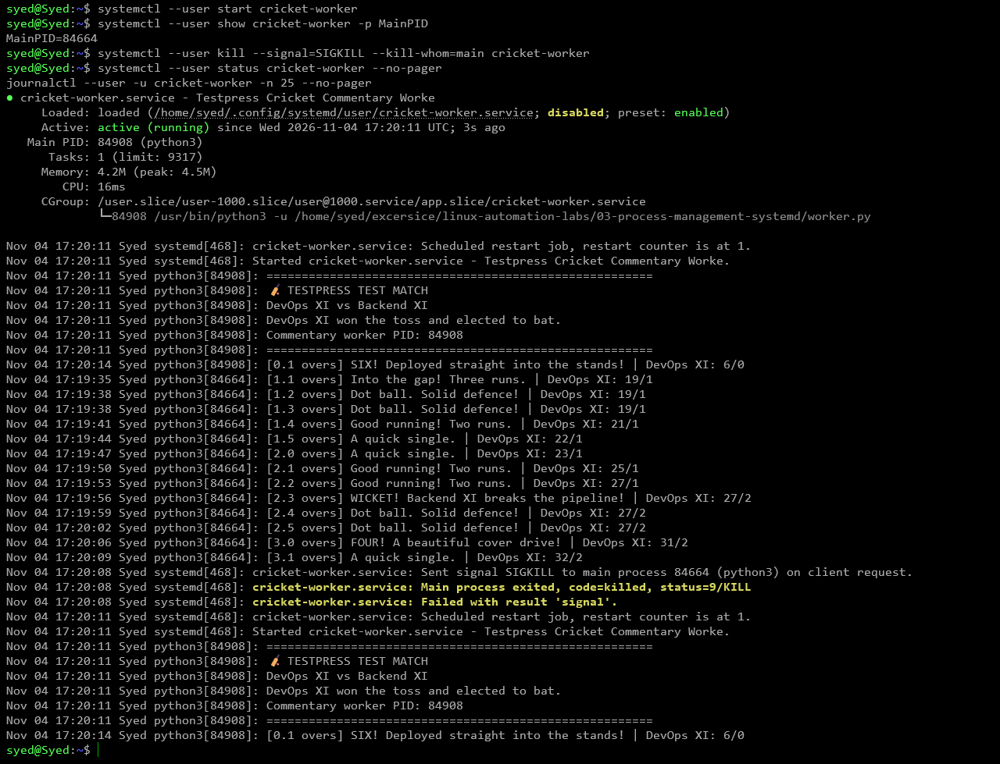

The new match started from zero because the score lived only in the old process's memory.

systemd reported `status=9/KILL`. This is the same signal that Bash reported as `137`
earlier, just shown in a different way.

I then sent SIGTERM:

```bash
systemctl --user kill --signal=SIGTERM --kill-whom=main cricket-worker
```

This time, the worker ended cleanly and stayed stopped. That matched `Restart=on-failure`:
an exit status of `0` is not a failure.

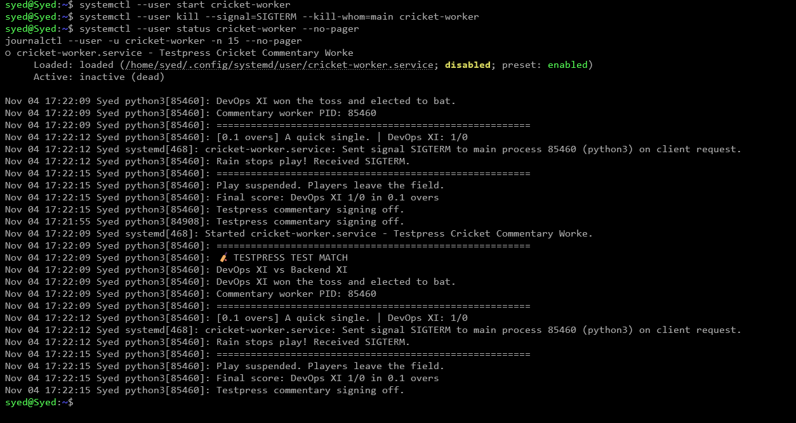

I also explored what `Restart=always` means. With that setting, a clean exit would start a
new match too. Even then, an explicit `systemctl stop` keeps the service stopped.

## Breaking the startup command

Next, I wanted to understand a service that would not start. I used an override to temporarily
replace the worker command:

```ini
[Service]
ExecStart=
ExecStart=/usr/bin/python3 /does-not-exist/worker.py
Restart=no
```

The empty `ExecStart=` removed the old command. The next line set a deliberately wrong
script path. I turned off restarts so I could inspect one failure.

I expected Python to complain that the file did not exist. After restarting the service,
the status showed `failed`, and the journal showed the missing file with exit status `2`.

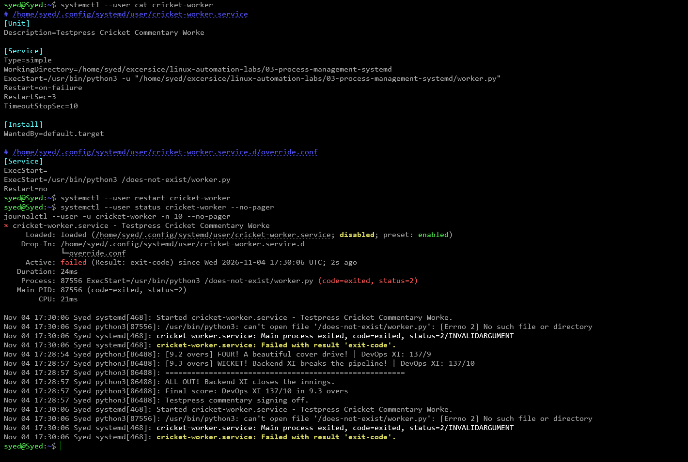

This taught me to use both status and logs. Status told me the service failed; the journal
told me why.

There was also an editor mistake along the way. The override was not being saved because
the settings needed to go above systemctl edit's “discard” line. Saving with Ctrl+O was not
enough if the text was in the wrong part of the file.

After removing the broken settings and reloading systemd, the worker ran again.

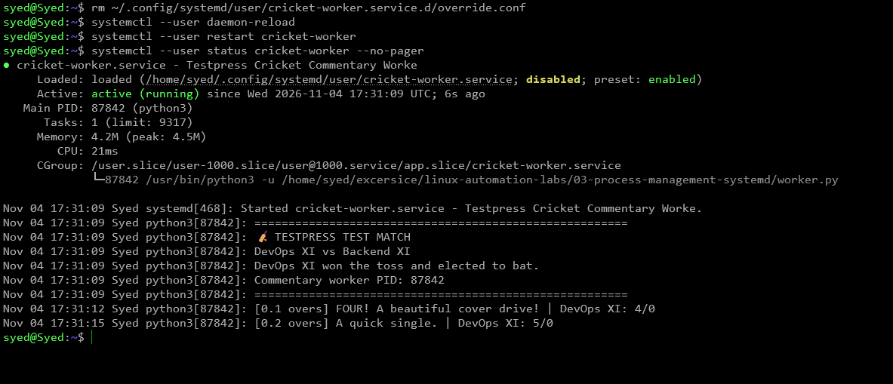

This test used a missing Python script. A missing executable is a different failure:
systemd would normally report `203/EXEC`. I have not captured that separate test yet.

## Giving the worker less memory

I added these limits:

```ini
[Service]
MemoryMax=50M
CPUQuota=20%
```

Then I checked what systemd had loaded:

```bash
systemctl --user show cricket-worker -p MemoryMax -p CPUQuotaPerSecUSec
```

It showed `MemoryMax=52428800` and `CPUQuotaPerSecUSec=200ms`.

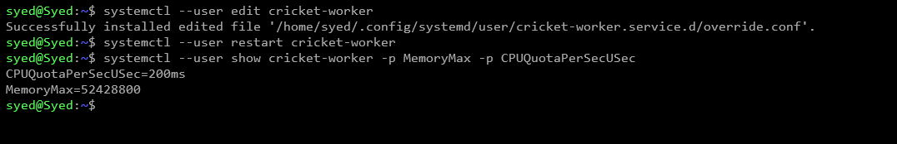

To push the memory limit, I temporarily replaced the cricket worker with a Python command
that allocated 200 MiB:

```ini
ExecStart=
ExecStart=/usr/bin/python3 -u -c "import time; print('Allocating 200 MiB', flush=True); data = bytearray(200 * 1024 * 1024); time.sleep(60)"
Restart=no
```

I expected Linux to kill it for using too much memory. That did not happen in this screenshot.
The process stayed alive with about 49.9 MiB in memory and 154.7 MiB in swap.

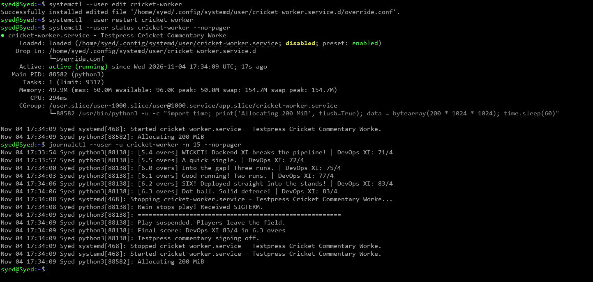

This was an important surprise. The memory limit did not also disable swap. The final service
now includes `MemorySwapMax=0`, so the next test can check what happens without swap.

I still need to run that final test and capture the actual result. I should not call the
earlier screenshot an out-of-memory kill.

## Giving it less CPU time

The cricket worker spends most of its time waiting, so it would not naturally use much CPU.
For this test, I temporarily ran a busy loop:

```ini
ExecStart=
ExecStart=/usr/bin/python3 -u -c "while True: pass"
Restart=no
```

I kept `CPUQuota=20%`, restarted the service, found its PID, and opened top:

```bash
systemctl --user restart cricket-worker
systemctl --user show cricket-worker -p MainPID --value
top -p 89654
```

I expected the loop to keep running but get only about 20% of one CPU core. top showed
`19.9%`, which matched that expectation.

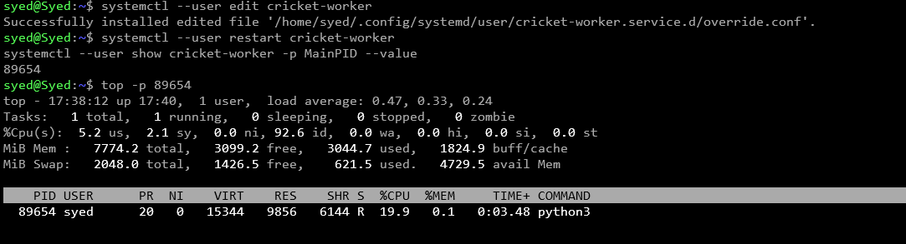

Unlike the memory test, excess CPU demand did not kill the process. Linux made it wait for
more CPU time. After the test, I removed the temporary command to restore cricket.

## Making the setup easier to share

The first service used my username and project path. Someone cloning the repo elsewhere
would have had to change them.

The final setup copies the app to `/opt/cricket-worker` and uses a separate account named
`cricket-worker`. This makes the setup independent of the clone location. The installer
needs sudo, but the Python worker runs as that separate account.

The final service is still called **cricket-worker.service**. Settings live in
`/etc/cricket-worker.env`. The [README](README.md) explains the installation.

The final app also fixes two small gaps in the first version: it uses a five-second heartbeat
and starts another innings after all out instead of ending the process.

## What I still need to capture

The screenshots above show the earlier experiments. The following parts still need personal
execution or screenshot evidence.

| Next test | What to capture |
|---|---|
| Process inspection | ps or pgrep showing the app and its PID |
| Final system service | Running status and the separate service account |
| App crash and repeated restarts | Exit status 1, restart attempts, and restart rate limiting |
| Memory without swap | Loaded limits and the actual out-of-memory result |
| Startup after reboot | Boot time, enabled state, and running service |

I also need to finish exploring `htop`, `pidof`, `pstree`, `pkill`, `nice`, `renice`,
`systemctl enable/disable`, and `systemd-analyze` wherever I have not recorded a result.

### Checking the process

After installing and starting the final service:

```bash
pgrep -af 'python3.*cricket-worker/app.py'
pidof python3
# Replace <PID> with the worker's actual PID.
ps -p <PID> -o pid,ppid,user,stat,ni,etime,args
pstree -p <PID>
top -p <PID>
htop
```

I expect Python to spend most of its time sleeping between messages. `pidof python3` may
show other Python programs too, so I need to check the command and PID carefully.

For priority, I can use a separate sleep process:

```bash
nice -n 10 sleep 100 &
# Use the PID printed by the shell.
renice -n 15 -p <SLEEP_PID>
ps -p <SLEEP_PID> -o pid,ni,args
kill <SLEEP_PID>
```

A larger nice number gives a process less priority when programs compete for CPU.
It does not set a fixed CPU limit.

For pkill, I can start `python3 app.py` manually and stop only that matching command:

```bash
pkill -TERM -u "$USER" -f '^python3 app[.]py$'
```

### Making the app crash repeatedly

In `/etc/cricket-worker.env`, I will temporarily set:

```text
HEARTBEAT_SECONDS=1
CRASH_AFTER=1
```

Then:

```bash
sudo systemctl reset-failed cricket-worker
sudo systemctl restart cricket-worker
sleep 15
sudo systemctl status cricket-worker --no-pager
sudo journalctl -u cricket-worker -n 70 --no-pager
```

I expect each run to print “Floodlight failure” and exit with status 1. The service allows
three starts in 30 seconds, so repeated crashes should eventually show “Start request
repeated too quickly.”

After recording the result, I will restore `HEARTBEAT_SECONDS=5` and `CRASH_AFTER=0`, then
reset the failed state and restart.

### Trying the memory test without swap

I will use `sudo systemctl edit cricket-worker` to temporarily add the same memory-allocation
command from the earlier test, with `Restart=no`. The final unit already has
`MemoryMax=50M` and `MemorySwapMax=0`.

```bash
sudo systemctl restart cricket-worker
sleep 3
sudo systemctl show cricket-worker -p MemoryMax -p MemorySwapMax -p Result
sudo systemctl status cricket-worker --no-pager
sudo journalctl -u cricket-worker -n 25 --no-pager
```

I expect an out-of-memory kill if Linux is enforcing these limits. I will record what actually
happens, then remove the temporary startup command and restore the worker.

### Checking startup after reboot

I will first restore normal settings and enable the service:

```bash
sudo systemctl enable --now cricket-worker
```

After restarting Linux, I will capture:

```bash
uptime -s
sudo systemctl is-enabled cricket-worker
sudo systemctl status cricket-worker --no-pager
sudo journalctl -b -u cricket-worker --no-pager
```

The README has the WSL restart steps. This test has not been recorded yet.

## What I took away

A process running is only the beginning. I now have examples of a clean stop, a forced stop,
a restart, a broken startup command, a resource limit, and a failed dependency.

The biggest lesson was to check the output instead of assuming the result. The memory test
was a good example: I expected a kill, but the screenshot showed swap use. Reading the status
and logs changed my understanding of what happened.

For a real worker, I would stop taking new jobs, finish or safely save the current job,
and then exit. systemd gives it time to do that before forcing it to stop.

## Checks on the updated files

Automated checks run by the assistant passed for signal handling, crash exit status,
invalid settings, and starting another innings after all out. The setup script passed
Bash syntax checks, and the service passed systemd's unit check.

These checks do not replace my own screenshots. The final system service still needs to be
installed and tested with sudo, and reboot evidence still needs to be captured.

## Extra: preparing the pitch before the match

For an extra experiment, I used a second service, `cricket-pitch.service`, as a dependency
of the commentary worker. The pitch had to be ready before the commentary could start.

The screenshots below show this dependency test using the earlier user service.
The pitch service was a small unit saved at
`~/.config/systemd/user/cricket-pitch.service`. Its reference template is
[cricket-pitch.service.template](cricket-pitch.service.template). It includes comments for
the normal run and the dependency failure test. There is no separate setup script for it.

The pitch service contained:

```ini
[Unit]
Description=Prepare the Testpress cricket pitch

[Service]
Type=oneshot
# Normal run: print a message and exit successfully.
ExecStart=/usr/bin/echo Pitch ready! Let the match begin.

# To simulate a dependency failure, comment out the echo line above
# and uncomment the line below. false exits with status 1.
# ExecStart=/usr/bin/false

RemainAfterExit=yes
```

This was a short task, so I used `Type=oneshot`. After it printed its message and finished,
`RemainAfterExit=yes` kept it marked as active.

I added this to the worker's override with `systemctl --user edit cricket-worker`:

```ini
[Unit]
Requires=cricket-pitch.service
After=cricket-pitch.service
```

`Requires=` brings in the pitch service. `After=` makes the match wait for pitch preparation
to finish. I expected both services to start in that order.

```bash
systemctl --user daemon-reload
systemctl --user start cricket-worker
systemctl --user status cricket-pitch cricket-worker --no-pager
```

The pitch showed `active (exited)` and the worker showed `active (running)`.

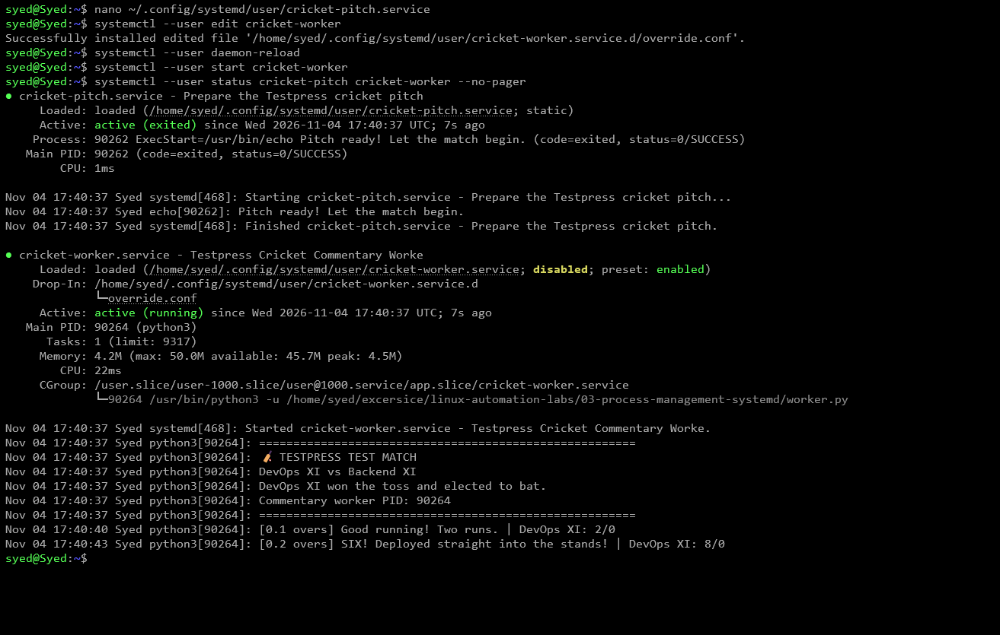

Then I stopped both services and changed the pitch command to `/usr/bin/false`.
That command always exits with status `1`.

I expected pitch preparation to fail and prevent the match from starting. The screenshot
shows exactly that: the pitch failed, and the worker stayed stopped with a dependency error.

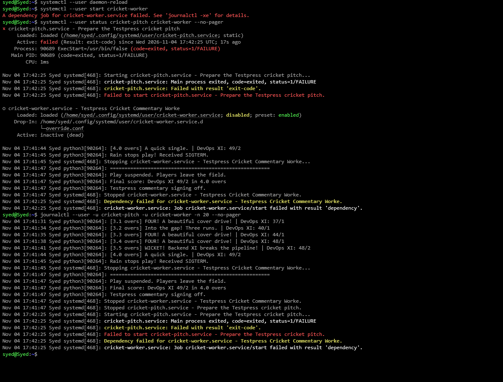

To restore it, I put back the echo command and ran:

```bash
systemctl --user daemon-reload
systemctl --user reset-failed cricket-pitch cricket-worker
systemctl --user start cricket-worker
```

This dependency was an extra learning exercise. It is not enabled in the final system service.

Later, a start command appeared to hang. I have not confirmed the cause. The right next step
is to check the queued jobs and both services:

```bash
systemctl --user list-jobs
systemctl --user status cricket-worker cricket-pitch --no-pager
journalctl --user -u cricket-worker -u cricket-pitch -n 40 --no-pager
```

Ctrl+C stops the waiting command in the terminal, but may leave systemd's job queued.
